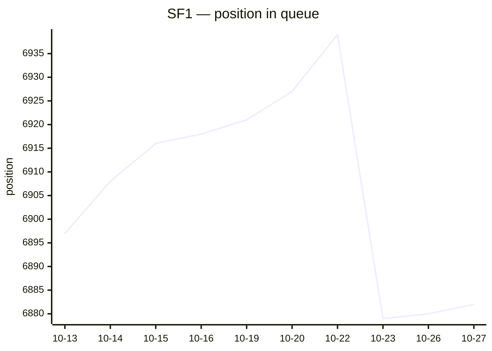
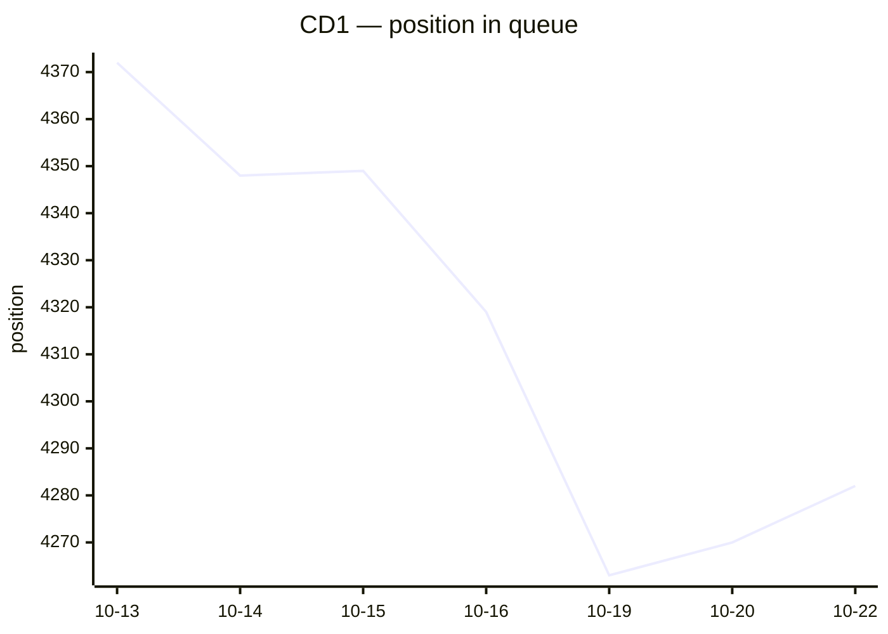

# Judgment queue tracker

Daily position of each process in the TRF1 chronological judgment queue
([ordem cronológica](https://sistemas.trf1.jus.br/ordemcronologica/)). Lower is closer to judgment.
Generated by `queue/track.py`; full history in `queue/data/`. Last update: 2026-10-28 00:45 BRT.

## SF1

`1023891-47.2023.4.01.3400` · 2º Grau · **DES. FEDERAL HERCULES FAJOSES** (TRF1)

| | |
|---|---|
| Position | **6882** (court data of 2026-10-27) |
| In this queue since | 2026-10-13 (first seen at 6897) |
| Advanced, last 7 days | +45 positions |
| Advanced, last 30 days | — |
| Pace, last 30 days | 1.8 positions/day → ~2037-05-14 (127 months) |
| Pace, whole queue | 1.8 positions/day → ~2037-05-14 (127 months) |

### Who is waiting, by month concluded (weekly)

Cases still in this queue, grouped by the month they were concluded to the judge.
A month's count dropping means its cases are being judged; the oldest months that
drop fast are the ones the judge is working on now.

| Concluded | 2026-10-27 | 2026-10-13 |
|---|---:|---:|
| before 2024-04 | 3371 | 3384 |
| 2024-04 | 56 | 56 |
| 2024-05 | 56 | 57 |
| 2024-06 | 49 | 50 |
| 2024-07 | 49 | 49 |
| 2024-08 | 66 | 67 |
| 2024-09 | 58 | 57 |
| 2024-10 | 62 | 62 |
| 2024-11 | 57 | 57 |
| 2024-12 | 32 | 32 |
| 2025-01 | 49 | 49 |
| 2025-02 | 98 | 97 |
| 2025-03 | 73 | 72 |
| 2025-04 | 133 | 132 |
| 2025-05 | 211 | 215 |
| 2025-06 | 239 | 238 |
| 2025-07 | 263 | 267 |
| 2025-08 | 269 | 271 |
| 2025-09 | 246 | 255 |
| 2025-10 | 385 | 381 |
| 2025-11 | 308 | 305 |
| 2025-12 | 210 | 210 |
| 2026-01 | 233 | 232 |
| 2026-02 | 244 | 237 |
| 2026-03 ← yours | 332 | 320 |
| after 2026-03 | 1966 | 1885 |
| **total** | **9115** | **9037** |

Earlier queue: **02ª - Brasília** (1º Grau), 1360 → 501 between 2024-08-06 and 2025-03-25 (231 days); it left that queue at position 501, not 0, so treat any ETA as a rough upper bound.

Last 15 readings

| Date | Position | Court |
|---|---:|---|
| 2026-10-27 | 6882 | DES. FEDERAL HERCULES FAJOSES |
| 2026-10-26 | 6880 | DES. FEDERAL HERCULES FAJOSES |
| 2026-10-23 | 6879 | DES. FEDERAL HERCULES FAJOSES |
| 2026-10-22 | 6939 | DES. FEDERAL HERCULES FAJOSES |
| 2026-10-20 | 6927 | DES. FEDERAL HERCULES FAJOSES |
| 2026-10-19 | 6921 | DES. FEDERAL HERCULES FAJOSES |
| 2026-10-16 | 6918 | DES. FEDERAL HERCULES FAJOSES |
| 2026-10-15 | 6916 | DES. FEDERAL HERCULES FAJOSES |
| 2026-10-14 | 6908 | DES. FEDERAL HERCULES FAJOSES |
| 2026-10-13 | 6897 | DES. FEDERAL HERCULES FAJOSES |
| 2025-03-25 | 501 | 02ª - Brasília |
| 2025-03-24 | 502 | 02ª - Brasília |
| 2025-03-20 | 495 | 02ª - Brasília |
| 2025-03-19 | 497 | 02ª - Brasília |
| 2025-03-18 | 499 | 02ª - Brasília |

## CD1

`1026558-69.2024.4.01.3400` · 2º Grau · **DES. FEDERAL NEWTON RAMOS** (TRF1)

| | |
|---|---|
| Position | **4282** (court data of 2026-10-22) |
| In this queue since | 2026-10-13 (first seen at 4372) |
| Advanced, last 7 days | +67 positions |
| Advanced, last 30 days | — |
| Pace, last 30 days | 11.8 positions/day → ~2027-10-19 (12 months) |
| Pace, whole queue | 11.8 positions/day → ~2027-10-19 (12 months) |

### Who is waiting, by month concluded (weekly)

Cases still in this queue, grouped by the month they were concluded to the judge.
A month's count dropping means its cases are being judged; the oldest months that
drop fast are the ones the judge is working on now.

| Concluded | 2026-10-20 | 2026-10-13 |
|---|---:|---:|
| before 2023-05 | 2809 | 2872 |
| 2023-05 | 204 | 208 |
| 2023-06 | 78 | 78 |
| 2023-07 | 42 | 43 |
| 2023-08 | 39 | 40 |
| 2023-09 | 28 | 28 |
| 2023-10 | 39 | 41 |
| 2023-11 | 25 | 26 |
| 2023-12 | 21 | 23 |
| 2024-01 | 25 | 25 |
| 2024-02 | 35 | 34 |
| 2024-03 | 34 | 36 |
| 2024-04 | 89 | 90 |
| 2024-05 | 97 | 97 |
| 2024-06 | 81 | 80 |
| 2024-07 | 63 | 63 |
| 2024-08 | 70 | 73 |
| 2024-09 | 90 | 94 |
| 2024-10 | 64 | 65 |
| 2024-11 | 61 | 64 |
| 2024-12 | 50 | 51 |
| 2025-01 | 62 | 65 |
| 2025-02 | 54 | 56 |
| 2025-03 | 78 | 84 |
| 2025-04 ← yours | 38 | 43 |
| after 2025-04 | 2523 | 2641 |
| **total** | **6799** | **7020** |

Earlier queue: **14ª - Brasília** (1º Grau), 143 → 33 between 2024-08-06 and 2024-11-29 (115 days); it left that queue at position 33, not 0, so treat any ETA as a rough upper bound.

Last 15 readings

| Date | Position | Court |
|---|---:|---|
| 2026-10-22 | 4282 | DES. FEDERAL NEWTON RAMOS |
| 2026-10-20 | 4270 | DES. FEDERAL NEWTON RAMOS |
| 2026-10-19 | 4263 | DES. FEDERAL NEWTON RAMOS |
| 2026-10-16 | 4319 | DES. FEDERAL NEWTON RAMOS |
| 2026-10-15 | 4349 | DES. FEDERAL NEWTON RAMOS |
| 2026-10-14 | 4348 | DES. FEDERAL NEWTON RAMOS |
| 2026-10-13 | 4372 | DES. FEDERAL NEWTON RAMOS |
| 2024-11-29 | 33 | 14ª - Brasília |
| 2024-11-28 | 33 | 14ª - Brasília |
| 2024-11-27 | 34 | 14ª - Brasília |
| 2024-11-26 | 37 | 14ª - Brasília |
| 2024-11-25 | 30 | 14ª - Brasília |
| 2024-11-22 | 28 | 14ª - Brasília |
| 2024-11-21 | 28 | 14ª - Brasília |
| 2024-11-20 | 28 | 14ª - Brasília |

