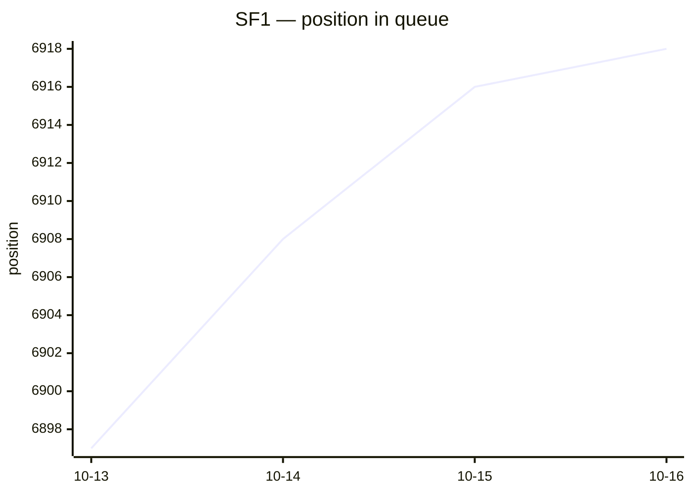
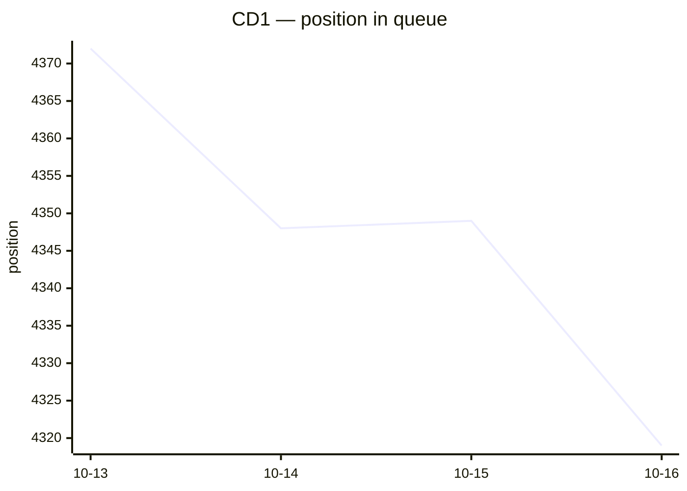

# Judgment queue tracker

Daily position of each process in the TRF1 chronological judgment queue
([ordem cronológica](https://sistemas.trf1.jus.br/ordemcronologica/)). Lower is closer to judgment.
Generated by `queue/track.py`; full history in `queue/data/`. Last update: 2026-10-17 00:59 BRT.

## SF1

`1023891-47.2023.4.01.3400` · 2º Grau · **DES. FEDERAL HERCULES FAJOSES** (TRF1)

| | |
|---|---|
| Position | **6918** (court data of 2026-10-16) |
| In this queue since | 2026-10-13 (first seen at 6897) |
| Advanced, last 7 days | — |
| Advanced, last 30 days | — |
| Pace, last 30 days | not moving forward |
| Pace, whole queue | not moving forward |

### Who is waiting, by month concluded (weekly)

Cases still in this queue, grouped by the month they were concluded to the judge.
A month's count dropping means its cases are being judged; the oldest months that
drop fast are the ones the judge is working on now.

| Concluded | 2026-10-13 |
|---|---:|
| before 2024-04 | 3384 |
| 2024-04 | 56 |
| 2024-05 | 57 |
| 2024-06 | 50 |
| 2024-07 | 49 |
| 2024-08 | 67 |
| 2024-09 | 57 |
| 2024-10 | 62 |
| 2024-11 | 57 |
| 2024-12 | 32 |
| 2025-01 | 49 |
| 2025-02 | 97 |
| 2025-03 | 72 |
| 2025-04 | 132 |
| 2025-05 | 215 |
| 2025-06 | 238 |
| 2025-07 | 267 |
| 2025-08 | 271 |
| 2025-09 | 255 |
| 2025-10 | 381 |
| 2025-11 | 305 |
| 2025-12 | 210 |
| 2026-01 | 232 |
| 2026-02 | 237 |
| 2026-03 ← yours | 320 |
| after 2026-03 | 1885 |
| **total** | **9037** |

Earlier queue: **02ª - Brasília** (1º Grau), 1360 → 501 between 2024-08-06 and 2025-03-25 (231 days); it left that queue at position 501, not 0, so treat any ETA as a rough upper bound.

Last 15 readings

| Date | Position | Court |
|---|---:|---|
| 2026-10-16 | 6918 | DES. FEDERAL HERCULES FAJOSES |
| 2026-10-15 | 6916 | DES. FEDERAL HERCULES FAJOSES |
| 2026-10-14 | 6908 | DES. FEDERAL HERCULES FAJOSES |
| 2026-10-13 | 6897 | DES. FEDERAL HERCULES FAJOSES |
| 2025-03-25 | 501 | 02ª - Brasília |
| 2025-03-24 | 502 | 02ª - Brasília |
| 2025-03-20 | 495 | 02ª - Brasília |
| 2025-03-19 | 497 | 02ª - Brasília |
| 2025-03-18 | 499 | 02ª - Brasília |
| 2025-03-14 | 511 | 02ª - Brasília |
| 2025-03-12 | 536 | 02ª - Brasília |
| 2025-03-10 | 567 | 02ª - Brasília |
| 2025-03-07 | 569 | 02ª - Brasília |
| 2025-03-06 | 570 | 02ª - Brasília |
| 2025-03-05 | 586 | 02ª - Brasília |

## CD1

`1026558-69.2024.4.01.3400` · 2º Grau · **DES. FEDERAL NEWTON RAMOS** (TRF1)

| | |
|---|---|
| Position | **4319** (court data of 2026-10-16) |
| In this queue since | 2026-10-13 (first seen at 4372) |
| Advanced, last 7 days | — |
| Advanced, last 30 days | — |
| Pace, last 30 days | 15.8 positions/day → ~2027-07-16 (9 months) |
| Pace, whole queue | 15.8 positions/day → ~2027-07-16 (9 months) |

### Who is waiting, by month concluded (weekly)

Cases still in this queue, grouped by the month they were concluded to the judge.
A month's count dropping means its cases are being judged; the oldest months that
drop fast are the ones the judge is working on now.

| Concluded | 2026-10-13 |
|---|---:|
| before 2023-05 | 2872 |
| 2023-05 | 208 |
| 2023-06 | 78 |
| 2023-07 | 43 |
| 2023-08 | 40 |
| 2023-09 | 28 |
| 2023-10 | 41 |
| 2023-11 | 26 |
| 2023-12 | 23 |
| 2024-01 | 25 |
| 2024-02 | 34 |
| 2024-03 | 36 |
| 2024-04 | 90 |
| 2024-05 | 97 |
| 2024-06 | 80 |
| 2024-07 | 63 |
| 2024-08 | 73 |
| 2024-09 | 94 |
| 2024-10 | 65 |
| 2024-11 | 64 |
| 2024-12 | 51 |
| 2025-01 | 65 |
| 2025-02 | 56 |
| 2025-03 | 84 |
| 2025-04 ← yours | 43 |
| after 2025-04 | 2641 |
| **total** | **7020** |

Earlier queue: **14ª - Brasília** (1º Grau), 143 → 33 between 2024-08-06 and 2024-11-29 (115 days); it left that queue at position 33, not 0, so treat any ETA as a rough upper bound.

Last 15 readings

| Date | Position | Court |
|---|---:|---|
| 2026-10-16 | 4319 | DES. FEDERAL NEWTON RAMOS |
| 2026-10-15 | 4349 | DES. FEDERAL NEWTON RAMOS |
| 2026-10-14 | 4348 | DES. FEDERAL NEWTON RAMOS |
| 2026-10-13 | 4372 | DES. FEDERAL NEWTON RAMOS |
| 2024-11-29 | 33 | 14ª - Brasília |
| 2024-11-28 | 33 | 14ª - Brasília |
| 2024-11-27 | 34 | 14ª - Brasília |
| 2024-11-26 | 37 | 14ª - Brasília |
| 2024-11-25 | 30 | 14ª - Brasília |
| 2024-11-22 | 28 | 14ª - Brasília |
| 2024-11-21 | 28 | 14ª - Brasília |
| 2024-11-20 | 28 | 14ª - Brasília |
| 2024-11-19 | 16 | 14ª - Brasília |
| 2024-11-18 | 16 | 14ª - Brasília |
| 2024-11-15 | 16 | 14ª - Brasília |

